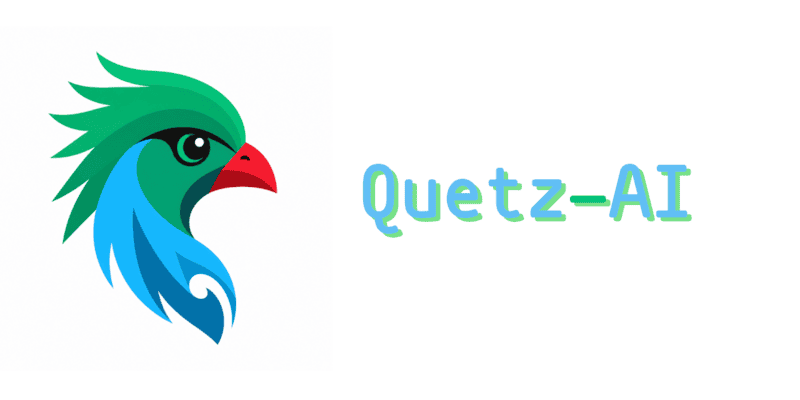

# Quetz-AI

<p align="center">
  
</p>

**A token-saver coding agent for small, focused changes.**

Hybrid: cloud planner + local executor. Minimal code that runs — you improve it in Emacs.

---

## What this is

Quetz-AI is **not** a replacement for Claude Code or OpenCode. It's a **fast, cheap alternative for small modifications** — the kind where you know what you want, but don't want to type 200 lines by hand.

It's designed for **one stack**: Python (FastAPI, Pydantic, LangGraph, Celery, Postgres/pgvector) + TypeScript (React, Vite, Tailwind, shadcn/ui).

**Not for:** giant codebases, complex refactoring, or tasks requiring deep architectural reasoning. For that, use Claude or OpenCode.

**For:** scaffolding, small features, CRUD endpoints, file structures, mockups, quick iterations.

---

## How it works

```
Your prompt
    │
    ▼
Cloud Planner (GPT-4o) ──► small task list (4-8 tasks)
    │
    ▼ (per task, stateless)
Context Compiler ──► minimal prompt (~1000 tokens)
    │                   target files + relevant skills + conventions
    ▼
Local Executor (Qwen3-Coder) ──► JSON edit plan
    │
    ▼
Atomic Editor ──► syntax check ──► git commit
```

Each task is **stateless** — no conversation history, no context bloat. After 10 iterations, the 11th task sees exactly the same amount of context as the first.

---

## Usage

```bash
# One-shot: plan + execute + exit
quetz-ai "create the folder structure for a clean architecture project in backend/"
quetz-ai "install vite and react on the frontend directory"
quetz-ai "create a py file named organization.py with CRUD mockup"
quetz-ai "create a mockup FastAPI endpoint for newsletter subscriptions"

# Interactive: REPL session until you quit
quetz-ai -i "build a newsletter API"
› add JWT auth
› create a simple React frontend
› quit

# Advanced: per-task control
quetz-ai execute --task T4 --executor cloud
quetz-ai plan "add authentication"
quetz-ai status
quetz-ai context --task T1 --show
```

---

## Design philosophy

**Minimal code, not perfect code.** The executor produces code that runs. You improve it manually in Emacs. No tests, no docstrings, no unnecessary error handling — just what works.

**Token-saver.** The context compiler sends ~1000 tokens per task, not 50K. The planner breaks goals into small tasks so the executor never overflows.

**Stateless by design.** No history accumulation. No endless loops. Each task is a fresh call.

**Hybrid models.** Cloud planner (fast decomposition) + local executor (cheap code generation). Switchable per-run:

```bash
quetz-ai --executor cloud "create endpoint"   # fast (GPT-4o)
quetz-ai --executor local "create endpoint"   # free (Qwen3)
```

---

## Stack

| Layer | Technologies |
|-------|-------------|
| Backend | Python, FastAPI, Pydantic, LangGraph/LangChain, Celery |
| Frontend | TypeScript, React, Vite, Tailwind CSS, shadcn/ui |
| Database | PostgreSQL, pgvector, SQLAlchemy, Alembic |
| Architecture | Clean Architecture (domain/application/interface/infrastructure) |
| Testing | pytest (minimal — only when you ask for it) |

---

## Setup

```bash
# Install
uv venv && uv sync

# Local executor (Ollama)
ollama pull qwen3-coder_IQ4XS:latest

# Cloud planner (OpenAI-compatible)
export OPENAI_API_KEY=...
export PLANNER_MODE=cloud
export PLANNER_MODEL=gpt-4o
```

---

## Configuration

```bash
# Models
PLANNER_MODE=cloud          # or local
PLANNER_MODEL=gpt-4o
EXECUTOR_MODE=local         # or cloud
EXECUTOR_MODEL=qwen3-coder_IQ4XS:latest

# Context budget
CONTEXT_TOKEN_BUDGET=6000   # max tokens per task prompt

# Auto-commit
AUTO_COMMIT=true            # commit after each successful task
GIT_BRANCH_PREFIX=quetz/
```

---

## Skills

Skills are markdown files in `skills/` that teach the executor how to write code for specific technologies. The context compiler retrieves only the relevant sections based on task type and stack.

```bash
skills/
├── ponytail.md          # minimal code philosophy (always active)
├── fastapi.md           # routes, dependency injection, error handling
├── pydantic.md          # strict schemas, validation
├── clean-architecture.md # layer boundaries, ports & adapters
├── react.md             # components, hooks, shadcn
├── typescript.md        # strict types, error handling
├── celery.md            # async tasks, idempotency
├── postgres-pgvector.md # SQLAlchemy, embeddings, migrations
├── langgraph.md         # state machines, nodes
└── pytest.md            # minimal testing
```

Add your own skills by dropping `.md` files in `skills/`. The format is documented in `skills/ponytail.md`.

---

## Workspace

```bash
.quetz/
├── tasks.json     # task queue
├── backlog.md     # human-readable plan
├── memory.md      # task decisions/pitfalls
└── index.db       # project index (git-ignored)
```

---

## License

MIT © Oscar Gallardo
